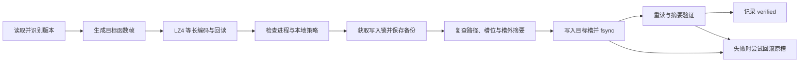

# LifeAfter_FPS · 明日之后帧率助手

Windows x64 本地帧率档位助手，当前版本 **v1.0.1**。提供版本检查、补丁预览、自动备份、应用后回读和备份恢复，默认 **120 FPS**。

| 项目 | 内容 |
| --- | --- |
| 档位 | 120 / 144 / 165 / 180 / 240 / 300 / 360 / 480 / 600 / 800 / 1000 FPS |
| 界面 | C# / Windows Forms / .NET 9 |
| 引擎 | Node.js 24.18.0 / ES Modules |
| 发布 | Windows 10/11 x64，自包含便携 ZIP |
| 支持范围 | 本工程已验证的 NXPK v3 脚本包；遇到未知版本停止写入 |

档位设置游戏脚本中的目标上限。实际帧率取决于硬件、场景和同步设置。发行验证证明补丁生成、写入及恢复的一致性；未对全部档位进行游戏内 FPS 测量。

## 下载与使用

在本仓库的 [Releases](https://github.com/pikai-pk/LifeAfter_FPS/releases) 下载 `LifeAfter_FPS-v1.0.1-win-x64.zip`。完整解压到可写目录，双击 `明日之后帧率助手.exe`。发行包包含运行环境，无需安装 .NET 或 Node.js。

1. 选择包含 `mingrizhihou.exe` 的游戏安装目录，点击 **检查版本**。
2. 在下拉列表选择档位。首次启动和从旧默认值版本首次升级时选中 **120 FPS**；之后记住上次选择。
3. 点击 **预览补丁**，核对当前状态、目标档位和包体支持状态。预览只在内存生成补丁。
4. 退出游戏及更新器，点击 **备份并应用**，等待回读检查完成。
5. 再点击 **检查版本**，然后启动游戏，用游戏计数器或独立 FPS 悬浮窗观察实际效果。

本程序提供帧率补丁界面。FPS 悬浮窗是另一个独立程序。

### 备份、恢复及偏好

- `backups/<时间戳>/original.slot.bin`：本次操作前的压缩槽位。
- `backups/<时间戳>/manifest.json`：包路径、槽位范围、原始/目标哈希和操作状态。
- `logs/*.json`：本地检查报告。
- `%LOCALAPPDATA%\LifeAfterFrameUnlocker\settings.json`：游戏目录、最近档位和默认值迁移标记。

点击 **恢复备份**，选择对应备份子目录中的 `manifest.json`。旧备份可以完整复制到新程序的 `backups` 目录后使用；恢复仍要求相同游戏路径、包体范围、槽外哈希和匹配的当前补丁哈希。

连续改档时，备份保存的是每次操作前的状态。恢复官方状态需选择 `originalState.kind` 为 `official` 的备份；必要时按相反顺序逐次恢复。**120 档位是明确设置调用参数为 120 的补丁，恢复官方脚本请使用备份恢复。**

## 技术栈与源码分工

| 文件或组件 | 实现内容 |
| --- | --- |
| `src/Program.cs` | WinForms 档位下拉、目录选择、异步子进程调用、结果展示、偏好保存；`--lz4` 二进制压缩辅助模式；`--verify-ui` 档位路由检查 |
| `src/FrameUnlocker.csproj` | .NET 9 Windows 自包含发布；引用 K4os.Compression.LZ4 1.3.8 |
| `程序/engine/cli.mjs` | check / plan / apply / restore 操作编排和 JSON 报告 |
| `程序/engine/archive.mjs` | Node crypto 的 AES-128-ECB 读取 NXPK 头部/索引；定位目标记录；读取本地写入策略 |
| `程序/engine/patch.mjs` | 校验当前模块，生成等长函数帧，识别补丁档位 |
| `程序/engine/recipe.json` | 已验证版本的摘要、模块标识、函数字段范围及原始函数帧模板 |
| `程序/engine/lz4-block.mjs` | 有界 raw LZ4 解压和格式校验 |
| `程序/engine/lz4-encode.mjs` | 将 LZ4HC 结果调节到固定槽长，并独立解压回读 |
| `程序/engine/transaction.mjs` | 排他写入锁、备份、并发变化检查、槽位写入、fsync、回读及失败回滚 |
| `程序/engine/processes.ps1` | 检查选定游戏目录中的游戏/启动器进程 |
| `build-release.ps1` / `package-release.ps1` | 发布、测试、白名单打包和 SHA-256 清单 |

GUI 用独立参数数组启动随包 Node.js，不将游戏路径拼接成 shell 命令。压缩由 GUI EXE 的 `--lz4` 模式完成，Node.js 负责验证与写入。

## 涉及的本地文件

以下路径均相对于用户选定的游戏目录：

| 文件 | 访问方式 | 用途 |
| --- | --- | --- |
| `Documents/script.py314.lc.npk` | 读取；校验通过后修改一个压缩槽 | 保存目标 SettingManager 脚本模块 |
| `Documents/file_hash_pack.bin` | 只读 | 识别 FHPK 清单，检查目标文件保护标记 |
| `Documents/configs/clientconfig` | 只读 | 读取 `last_login_server_theme` 供写入策略判断 |
| `mingrizhihou.exe` | 检查存在性 | 校验选择的安装目录 |
| `Documents/script.py314.lc.npk.independent-fps.lock` | 操作期间创建，结束时移除本次创建的锁 | 避免并行写入 |

游戏包内的修改范围是 **SettingManager.set_frame_rate 对应的序列化函数帧**。引擎从索引定位槽位，实际文件偏移由该包的索引决定。

## 帧率解锁模块：本地技术说明

### 1. 包体和模块识别

1. 读取并用包格式内置密钥解码 NXPK 头部和索引；检查签名、版本、索引计数和边界。
2. 在 48 字节索引记录中，通过 `recipe.json` 的 `nameHash` 和 `nameId` 定位唯一目标模块。
3. 要求压缩类型为 LZ4、压缩槽长 **106,919 字节**、解压模块长 **315,527 字节**。
4. 官方模块必须匹配 SHA-256：

   ```text
   d7a7c7a4db42c83483c1d5b5d191c5d0d2f21c68e9a1ea7a7fb13175e7bfccd5
   ```

5. 若当前为本程序生成的补丁，重新构建候选函数帧并逐字节比对，再将该帧归一化为官方模板验证整个模块摘要。未知函数修改或其他模块内容变化会终止操作。

### 2. 覆盖函数入口的 frame 参数

目标函数接受 `self, frame`。根据本地自定义字节码布局的解析和语义推断，补丁在入口初始化之后插入：

```text
LOAD_CONST 目标FPS
STORE_FAST frame
执行原有函数主体
```

对应当前已审计虚拟机布局的插入字节为 `44 02 76 01`，即常量槽 2 和局部变量槽 1。函数常量元组从 2 项扩展为 3 项，新增一个 32 位整数常量；后续主体继续使用覆盖后的 `frame` 参数。

这些操作码属于目标的自定义布局，语义来自本地解析及结构推断；它们不能直接套用普通 CPython 的操作码表。源码测试验证结构和补丁识别，未通过执行游戏虚拟机来独立证明每条操作码语义。

### 3. 保持序列化函数帧等长

函数帧位于解压模块的半开区间 `[270516, 272071)`，共 **1,555 字节**。引擎做四项调整：

| 调整 | 长度变化 |
| --- | ---: |
| 函数字节码入口增加两条指令 | +4 字节 |
| 常量元组新增整数 | +5 字节 |
| 行号表新增入口映射 | +2 字节 |
| qualname 从 `SettingManager.set_frame_rate` 改为 `FPS.set_frame_rate` | −11 字节 |
| 合计 | 0 字节 |

`co_name` 保持 `set_frame_rate`。缩短的限定名承担长度补偿；函数帧前后所有字节必须逐字节相同。

### 4. 固定大小 LZ4 槽

修改后模块交给 K4os LZ4HC `L12_MAX` 压缩，再用独立 JS 解码器校验。引擎通过将部分匹配字节转为字面量，调节合法 LZ4 token 的编码长度，直到恰好为 **106,919 字节**。

最终 LZ4 槽必须完整解压成期望模块。压缩后超长、无法精确调节到目标长度或回读不一致，均终止操作。该实现保持原有索引记录和槽位大小，不更新包索引或外部游戏完整性清单。

### 5. 事务写入和恢复



引擎在写入前后验证文件大小、文件身份、目标槽 SHA-256 和槽外所有区域的 SHA-256。写后校验失败时尝试恢复原槽，并记录 `slot-restored` 或 `failed`。本地策略要求识别到 FHPK 和上次区服信息，受保护且区服标记为 `yk` 时拒绝修改。

这是基于本地游戏包生成的独立补丁。功能实现和发布包不依赖原工具的账号授权或加密补丁缓存。

## 从源码构建与验证

构建机器需安装 **.NET 9 SDK** 和 PowerShell 7。第三方许可证在 `程序/licenses` 中。运行环境和大型构建产物通过发行包分发，不提交到源码 Git 历史。

```powershell
# 在仓库根目录执行；下载官方 Node.js x64 并验证固定 SHA-256
./bootstrap-runtime.ps1

# 构建 Windows x64 自包含发行目录
./build-release.ps1

# 提供自己本地兼容的官方脚本包及同目录所需清单/配置，执行副本测试后打包
./package-release.ps1 -TestArchive 'D:\Games\LifeAfter\Documents\script.py314.lc.npk'
```

可以使用 `bootstrap-runtime.ps1 -NodeExecutable <本地node.exe路径>` 复用匹配版本的本地运行环境。测试包源需为官方模块状态，旁边需有 `file_hash_pack.bin` 和 `configs/clientconfig`。打包过程复制整个包到隔离测试目录，只在副本上应用和恢复。

`tests/prepare-test-fixtures.mjs` 从自己本地兼容的包生成模块测试样本；样本、游戏包副本、个人备份和日志由 `.gitignore` 排除。

### 已验证项目

- GUI 默认 120 和所有下拉档位传入检查、预览、应用、恢复操作。
- 120–1000 档位范围及边界；只改变目标函数帧。
- 300 档位与本地独立工作器样本的固定 SHA-256 一致。
- 所有发行档位的 LZ4HC / JS 解码结果一致，槽长严格等长。
- 未知模块、损坏数据、已有锁和并发修改被拒绝。
- 注入写后校验失败时，原槽回滚一致。
- 完整游戏包副本：检查 → 预览 → 应用 → 重查 → 重复应用不写入 → 恢复 → 重查；恢复后整个文件 SHA-256 与测试前相同，源文件保持不变。
- ZIP 内发行文件逐项验证 SHA-256。

摘要见 Release 内的 `验证结果.json` 和 `SHA256SUMS.txt`。

## 源码发布范围和许可证

源码仓库包含 GUI、引擎、构建脚本、测试代码、文档和第三方许可证；发行 ZIP 放到 GitHub Release。研究提取结果、完整游戏脚本、游戏包、个人备份、日志及设置文件保留在本地。

项目源码尚未单独指定开源许可证。Node.js、.NET 和 K4os 的许可条款分别见 `程序/licenses`；发布包也附带这些文件。
